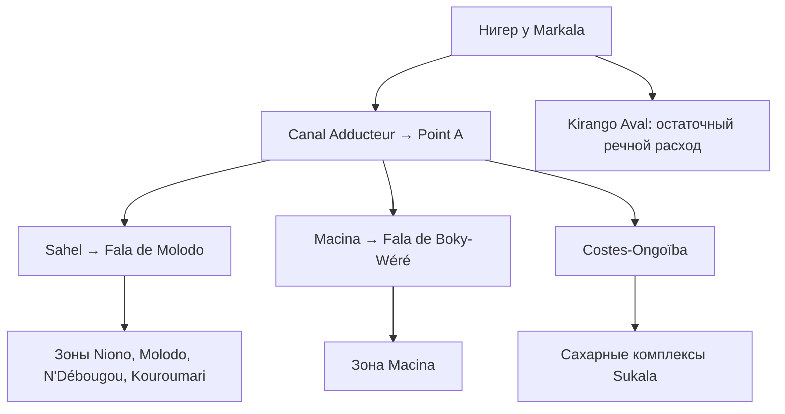

# Markala → Office du Niger: проверка физической связи и реальные ряды

**03.11.2026. Результат:** документально установлена связь водозабора с историческими зонами орошения; получены и проверены четыре месячных гидрологических ряда. Связь с конкретными современными полигонами полей и фактической подачей по каналам ещё не установлена. Это разные уровни готовности.

## 1. Что связано с чем

Историческая схема подтверждена GRET (2002), раздел 2.2, стр. 8–9 [GRET2002]. Рёбра сохранены в `hydraulic_links.csv`, ссылки — в `evidence_sources.csv`. Это направленная схема водоснабжения, не географическая карта и не перечень всех сегодняшних каналов.



Для Macina источник также называет периметры Sossé Sibila, Niaro, Boki-Were, Kokry, Ké-Macina. Это подтверждает назначение ветви, но не даёт границ полей, актуальных для каждого года. Современные расширения, M'Bewani и hors-casiers нельзя автоматически включать в историческую классификацию.

**Единица будущего анализа:** блок орошения (*casier*) × сельскохозяйственный сезон × год, при наличии согласованных границ, входной подачи и посевной площади. Термин casier не следует автоматически отождествлять с отдельным полем или конкретным порядком канала: требуется технический справочник Office du Niger. Район Ségou для этого слишком крупный; он остаётся только климатическим контекстом.

## 2. Что скачано и проверено

Rouché et al., **SIEREM, DOI [10.23708/FWC87Z](https://doi.org/10.23708/FWC87Z), версия 2.0**, лицензия CC BY 4.0. Скачан архив `45088` (3 554 029 байт), MD5 `3122f157092c54854d99dd0d212b76fc` совпал с опубликованным. Сохранены четыре исходных текстовых ряда без изменения байтов, исходная таблица станций и README. SHA-256, пути членов архива и происхождение находятся в `source_manifest.json`. Условия этого набора отличаются от ограничений GRDC: не переносить разрешение CC BY на будущие файлы GRDC.

Документация SIEREM, стр. 2 [SIEREM_NOTICE], подтверждает **месячный шаг, л/с и пустые ячейки для отсутствующих значений**. Хотя каталог называет исходные серии `Debit journalier`, скачанные файлы содержат месячные агрегаты. Это не суточные наблюдения.

| Пост | Фактические непустые месяцы: начало–конец | Значений | Пустых строк | Полных календарных лет | Назначение |
|---|---|---:|---:|---:|---|
| Koulikoro | 1907-01 — 1999-07 | 1 107 | 4 | 91 | Верхний речной контроль, не измерение отвода |
| Kirango Aval | 1925-08 — 1983-12 | 395 | 313 | 13 | Речной контроль ниже Markala |
| Banankoro | 1967-11 — 1999-06 | 272 | 119 | 16 | Верхняя граница речного притока |
| Sélingué | 1964-07 — 1999-02 | 390 | 33 | 27 | Контекст Sankarani; не сертифицированный ряд выпусков ГЭС |

Итого: **2 633 календарных строки; 2 164 значения, 469 пропусков**. Начало и конец не означают сплошное покрытие. Число полных лет относится только к наличию 12 месячных значений; полнота исходных суток неизвестна.

У Koulikoro и Kirango **395 общих непустых месяцев**, из них **25 с 1981 г.** Эти данные дают историческую диагностическую основу, но не обеспечивают современную панель с CHIRPS и WaPOR. Описание станции и фактический файл местами различаются по датам; обе версии сохранены в `outputs/coverage.csv`.

## 3. Пространственная перепроверка: найден конфликт

Из вложенных архивов извлечены точечные координаты; `.prj` задаёт WGS84. В таблице станций CRS не указан. При условном сопоставлении в одной географической системе получены расстояния:

| Пост | CSV ↔ точечный shapefile, км |
|---|---:|
| Koulikoro | 1.368 |
| Kirango Aval | 2.534 |
| Banankoro | 0.588 |
| Sélingué | 10.307 |

Обе версии сохранены в `outputs/coordinate_discrepancies.csv`. Вариант «более точные десятичные координаты значит более правильные» отвергнут. Причина может быть в смене створа, другом типе объекта или ошибке метаданных; она пока неизвестна. **Ни одна версия не объявлена истинной, автоматическое snapping к речной сети не выполнено.** Бассейн гидропоста также не равен границе орошаемых полей.

## 4. Правильная постановка водного баланса

По Munier et al. (2015), раздел 2 [MUNIER2015], Kirango расположен ниже Markala; водоотвод и потери меняют расход между верхними постами и этим створом. Sélingué влияет на маловодный сток. Поэтому Koulikoro — уже регулируемый сигнал, а не естественный сток без воздействия человека.

Для выбранного контрольного объёма у Markala нужно проверять баланс:

`Q_up + Q_lateral = Q_down + Q_diversion + Q_losses + dS/dt`.

Все члены выражаются в м³/с; изменение запаса — тоже скорость изменения объёма. Если нижний створ — Kirango, учитываются участок до него и временная задержка. Если отвод оценивается по Point A, отдельно учитываются потери, изменение запасов и прочие отборы между входом в Canal Adducteur и Point A. **Сумма трёх расходов у Point A не автоматически равна отводу из реки в тот же момент.**

Файл `paired_gauges_diagnostic.csv` содержит лишь одновременную разность Koulikoro−Kirango. В **114 из 395** общих месяцев она отрицательна. Это повод изучать задержки, боковой приток, режим и качество данных; не «отрицательное орошение» и не основание обнулять разности. Ни один из этих остатков не записан как измеренная подача.

Для оценки водообеспеченности блока нужны:

1. Объём фактической подачи на его входе и подтверждённая обслуживаемая площадь за тот же период.
2. Потребность в той же точке баланса: полевые потребности с учётом эффективных осадков, режима риса и потерь доставки. Нельзя сравнивать отвод всей системы с ET отдельных полей.
3. Даты и длительности дефицита относительно агрономических фаз. Месячные данные не восстанавливают суточные перебои.
4. Уровень воды у водозабора, режим затворов, ограничения пропускной способности, работы на каналах и требования ниже по течению. Порог 50 м³/с из исследовательской модели не кодируется как подтверждённая действующая правовая норма.

`Q_m3_s = Q_l_s / 1000`. Для интегрирования среднего расхода требуется подтверждённое покрытие интервала и правило агрегации. В этой сборке **месячные объёмы не рассчитаны**, поскольку число исходных суток и правило агрегации не документированы. Нули сохранены как нули; пустые значения не заполняются. Недостающие даты, CRS и статусы не выводятся из похожих названий.

Экономический анализ имеет смысл после согласования подачи, потребности и выпуска на одном уровне: например, связь сезонной нехватки воды с урожайностью/потерями производства внутри системы. Наблюдаемая недоподача может быть следствием управления, ремонта или распределения; её нельзя заранее назвать климатической засухой. Причинный эффект трансграничных институтов потребует отдельного доказательства механизма и идентификации.

## 5. Где взять недостающую связку

FAO описывает IPON как систему, совмещающую WaPOR и наземные данные водоподачи по зонам и casiers [FAO_IPON]. IWMI сообщает, что обновлением системы занимается Office du Niger [IWMI2026]. Это наиболее прямой найденный маршрут к согласованным геометриям и подаче. **Открытая выгрузка этих первичных таблиц и геометрий не получена.** Поиск WAPORWA дал вычислительный инструментарий, а не подтверждённую историю полигонов полей Office du Niger.

| Пакет | Предпочтительный держатель | Обязательные поля / критерий приёмки |
|---|---|---|
| Границы casiers и полей | Office du Niger / техническая команда IPON, IWMI | Стабильные ID; CRS; даты действия; обслуживающий канал; точка входа; тип площади — оборудованная/посевная/убранная |
| Подача Point A и блокам | Office du Niger, служба эксплуатации сети | Время; м³/с или м³ с правилом расчёта; шаг; пропуски; метод измерения; затворы; ремонт; код узла |
| Створы и расходы | DNH Mali / IRD-SIEREM; GRDC для доступных постов | Координаты и история створа; кривые расходов; суточные H/Q; измерено/восстановлено; даты перекрытия с блоками |
| Регулирование | Оператор Sélingué / DNH | Различить приток к водохранилищу, выпуск, уровень и речной пост с тем же названием |

В статье Schröder et al. (2019), раздел 2.1 [SCHROEDER2019], использован Koulikoro до 2006 г.; данные доступны по запросу авторам. Это другой архивный срез, не продолжение уже скачанного файла. Прежде чем объединять источники, нужны проверка идентичности створа и сравнение перекрывающихся значений. Diré, Koryoumé, Ansongo и Kandadji из этой статьи не подходят как прямой верхний контроль водозабора Markala.

Подготовлен `DATA_REQUEST_FR.md`: два конкретных пакета запросов, **не отправлены**. После получения геометрии необходимо проверить валидность, площади в метрической проекции, пересечения и направление каналов; после рядов — календарь, единицы, флаги качества и замыкание баланса с допуском, основанным на погрешности измерений.

## 6. Воспроизводимость и проверка

```bash
python research/basin-data-audit/article1_hydrology/markala/build_markala.py
python research/basin-data-audit/article1_hydrology/markala/test_markala.py
```

Дополнительная онлайн-проверка: `python research/basin-data-audit/article1_hydrology/markala/verify_download.py`. Она повторно получает архив и сравнивает его контрольные суммы, CRC, исходные ряды, извлечение точек, таблицу станций и README с сохранёнными файлами; ничего не перезаписывает.

Пять тестов проверяют каждое преобразованное значение против исходного файла, сохранение пропусков, независимый расчёт перекрытия, конфликты координат и направленную документальную сеть. Предыдущие шесть тестов базовой сборки сохраняются. Это подтверждает обработку и внутреннюю согласованность, **не заменяет полевую валидацию исходных расходов**.

Базовый `../outputs/discharge_observations.csv` относится к первой сборке/постам Вольты и остаётся пустым. Новые ряды Нигера расположены отдельно в `markala/outputs/monthly_discharge.csv`: у них другая система ID, источник и неопределённость месячной агрегации. Их нельзя присоединять к старой таблице без явного обновления схемы.

**Решение по готовности:** историческая гидрология — доступна с оговорками; связь до зон — документирована; точные поля, современная подача и их совместный период — ещё требуют данных владельца. Новую научную претензию следует строить после этой проверки, а не обещать новизну по одному наличию речного ряда.
