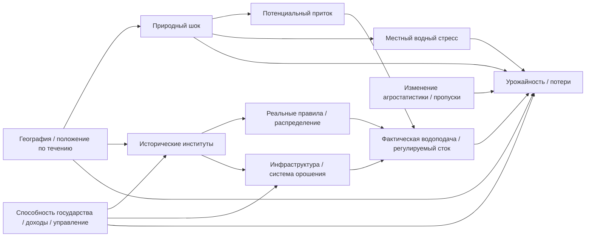

# Working Pre-Analysis Plan & DAG v1
**03.11.2026 · Exploratory-then-confirmatory plan; НЕ зарегистрированная preregistration.**

## Концептуальный DAG (схема причинной логики)

**Интерпретация:** фактический регулируемый сток/водоподача — возможный медиатор; механическое включение в модель оценки общего институционального эффекта создаёт post-treatment bias. Инфраструктура может быть и предтритментным модератором, и продуктом институционального воздействия: нужна дата её строительства.

## Величины и единицы

- Observation: `district_ID × crop × season × production_system × harvest_year`. Не складывать `All` и `Irrigated`. `yield` в т/га, `production` в т, `area` в га; `yield=production/area`.
- Primary `Y=ln(yield)` после `yield>0, area>0, production>0, qc=0`. Качество пропусков — отдельное исследование, отбор не по итоговому коэффициенту.
- Primary shock: отрицательная стандартизированная сезонная аномалия метеорологического/верховьевого **потенциального** водообеспечения, определённая по релевантному периоду посев–уборка. Основной момент — harvest-year crop calendar; для трансграничной схемы нужны водозабор и upstream catchment.
- Fixed climatology proposed **1981–2010**, только там, где достаточно базовых климатических месяцев, последовательно для всех территорий. По данным 2011–2024 baseline не пересчитывать задним числом; проверить альт. норму.
- Institutional features: датированные до природного шока, только при документированной географической применимости и проверенном действии. Иначе UNKNOWN.
- Controls: заранее заданные local rainfall and temperature, район/культура×сезон FE, national-year or year FE where statistically identifiable; проверить поглощение I×D при basin-year FE.
- По числу кластеров: **бассе́йны/режимы, не пиксели**. Wild cluster bootstrap может быть недостаточным при 2–3 treated regimes; не представлять его как «исправление» отсутствующей вариации.
- Многократные сравнения: заранее одна primary спецификация, остальные чувствительность с полным отчётом, не выборочный поиск p-value.

## Базовая спецификация ассоциации, не causal claim

`log(yield_{d,k,s,t}) = FE_{d,k,s} + FE_t + beta*shock_{d,k,s,t} + theta*(shock × regime_before_t) + gamma*pre_shock_covariates + epsilon`.

**Проблема:** режим может не изменяться на протяжении всей выборки; `theta` отражает неоднородность реакции между разными бассейнами и может смещаться из-за неоднородных ненаблюдаемых детерминант. Если `shock` только basin×year, `basin×year FE` уничтожит `shock` и `shock×regime_b`.

Результат базовой модели: условная разница в чувствительности, SE/CI учитывают доступные независимые бассейны; если их 2–3, анализ в основном описательный, без обещания обычных p-value.

## Отдельная причинная ветвь (только после institutional gate)

Event study/DiD **допускается**, но не предполагается. Требуется одновременно:
- наблюдаемая датированная и **практически внедрённая** реформа, связанная с исследуемым водозабором;
- убедимая контрольная группа, не получающая эффект через гидрологические spillover;
- достаточные pre/post годы одной и той же outcome definition;
- pre-trends (не доказательство parallel trends), отрицательные и временные placebo, sensitivity к альтернативным датам реформ;
- учитывать staggered/heterogeneous adoption вместо наивного двухфакторного TWFE, если реформ несколько.

При отсутствии этих условий — **comparative case study с process tracing и количественными связями климат–урожайность, без causal claim о договоре**.

Методологические ориентиры: [Roth et al. (2023), Journal of Econometrics](https://doi.org/10.1016/j.jeconom.2023.03.008), [Cameron et al. (2008), Review of Economics and Statistics](https://doi.org/10.1162/rest.90.3.414). Особенно: wild bootstrap не заменяет адекватную институциональную вариацию.

## Отрицательные контроли / проверка гипотез

1. Преимущественно богарные районы как гетерогенность, **не автоматическое placebo** (осадки воздействуют на всех).
2. Нерелевантные для местного crop-season месяцы как falsification при биофизическом обосновании; учитывать сезонную автокорреляцию.
3. Буферизация урожайности может сопровождаться ростом орошения/изменением площади, поэтому yield и production рассматривать отдельно.
4. Диагностика пространственной зависимости, границ BCU и изменения административных единиц.
5. Полный отчёт обо всех предварительных спецификациях и отрицательных результатах.
